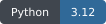
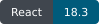
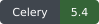
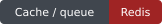
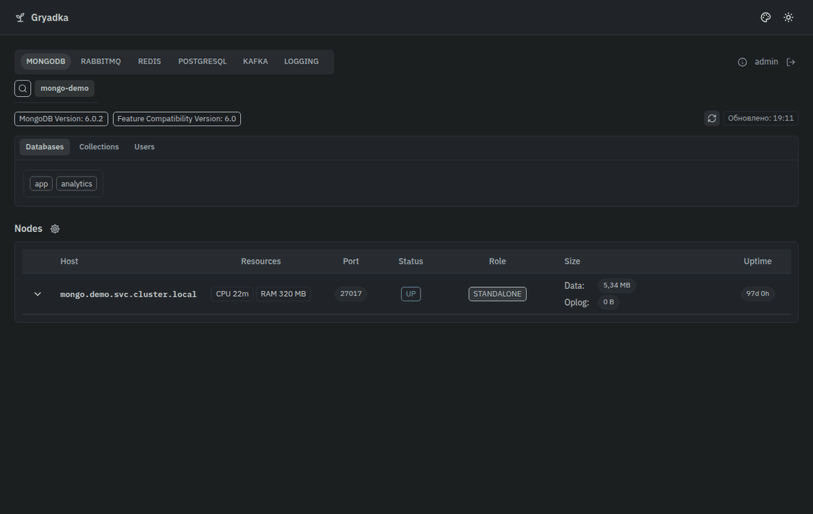
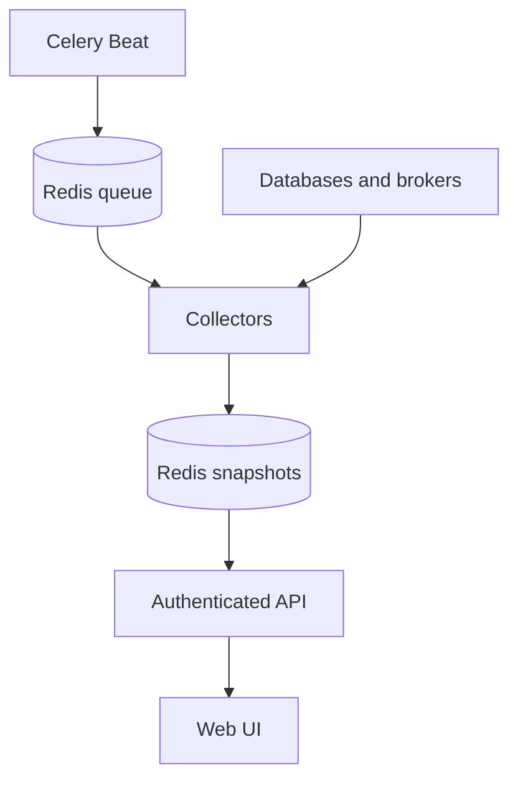

<p align="center"></p>
<h1 align="center">Gryadka</h1>
<p align="center">Database and broker health in one operational dashboard.</p>
<p align="center">
  
  
  
  
  
</p>

Gryadka collects infrastructure statistics in the background and shows the last known state with its observation time. Inspect MongoDB replication, RabbitMQ queues, Redis, PostgreSQL and Kafka/Redpanda without assembling a separate tool for every engine.

## See it in use



The recording uses synthetic API responses in the real frontend. It does not contact monitored systems. [Static screenshot](assets/readme/screenshot.png) · [Reproduce the demo](docs/demo.md)

## Run locally

Docker with Compose is required:

```sh
git clone https://github.com/ArtefactoO/gryadka.git
cd gryadka
cp .env.example .env
# Set JWT_SECRET and AUTH_USER_ADMIN_PASSWORD in .env.
docker compose up -d --build
```

Open **http://localhost:8082**, then sign in as `admin` with the password you set. Compose starts the API, Celery worker, scheduler and an isolated Redis instance. The sample monitor observes that local Redis.

Add your own targets in `config.example.yaml`. Credentials are read from environment variables. Stop with `docker compose down`. Redis is ephemeral in this local setup.

## What you can inspect

- MongoDB members, replication lag, databases, collections and indexes.
- RabbitMQ nodes, queues, connections and users.
- Redis nodes, replication and database counters. Key browsing requires separate permissions.
- PostgreSQL connections, replication, databases, table/index metadata and optional HBA helpers.
- Kafka and Redpanda brokers, topics, partitions and consumer lag.
- Optional HAProxy, Elasticsearch, EMQX, Kubernetes and host-resource views when configured.

Catalog details load on demand. A failed refresh keeps the previous snapshot visible and marks the failure. PostgreSQL monitoring reads metadata and statistics, with read-only transactions and bounded timeouts. It does not collect SQL text or application rows.

Queue deletion, key access and other administrative actions require explicit application permissions and matching target privileges. Monitoring access does not grant them automatically.

## How data arrives



## Development

```sh
docker build -f deploy/Dockerfile -t gryadka:local .
cd frontend
npm ci
npm run test:ui
npm run build
```

Backend checks use `pytest -q -p no:cacheprovider tests` with `backend/requirements.lock` and the test dependencies from the GitHub workflow. Integration scenarios require a disposable target environment and explicit opt-in. Gitleaks runs automatically on pull requests and pushes to `main`. Frontend/backend checks and image builds run only through **Actions → CI → Run workflow**.

## Documentation

Documentation is in English. Some interface labels are currently in Russian.

| Task | Guide |
| --- | --- |
| Configure targets and local services | [Configuration](docs/configuration.md) |
| Understand monitors and access boundaries | [Monitoring guide](docs/monitoring.md) |
| Install the PostgreSQL metadata helper | [SQL helper](docs/sql/postgresql-monitor.sql) |
| Deploy the container | [Deployment](docs/deployment.md) |
| Understand themes and interface conventions | [Design](frontend/DESIGN.md) |

See [CONTRIBUTING.md](CONTRIBUTING.md) and [SECURITY.md](SECURITY.md).

## License

Original project code is licensed under the [MIT License](LICENSE). Third-party dependencies and assets retain their own licenses and notices.
